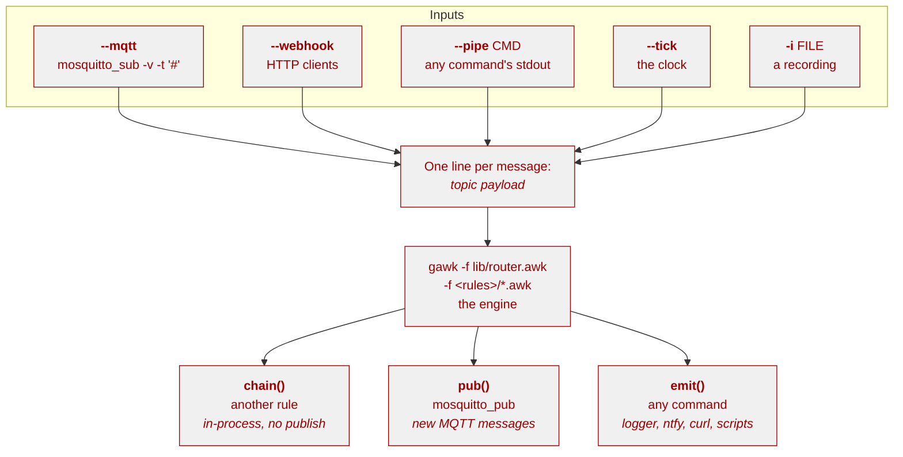

# awk-red 

> awk-red is to MQTT what AWK is to text files

> [!WARNING]
> v0: The interface is subject to change!

A Node-RED style event router built on a small AWK engine, with MQTT, HTTP, a
clock or a command's stdout as the inputs.

Node-RED is built on a handful of simple ideas:

1. subscribe to events
2. filter them
3. transform the data
4. decide something
5. call an external program or publish a new message

AWK's `pattern { action }` model covers exactly those steps: pattern matching
filters, the action body transforms and decides, and `system()` calls out to
other programs. awk-red is that idea implemented as two files - a shell script
that handles what AWK is bad at, and a small AWK engine that routes.

Inputs are opt-in and each one is asked for separately: `--mqtt` subscribes to
a broker, `--webhook` serves HTTP webhooks, `--tick` adds a clock, `--pipe`
runs a command, `-i` replays a recording. A run needs at least one of them.



The engine never changes when automations are added. A rule is a new file in
a rule directory, and nothing else.

## Requirements

| Tool | Why | Install |
| --- | --- | --- |
| `bash` >= 4.4 | the entry point | ships everywhere |
| `gawk` >= 4.0 | indirect calls, two-way coprocesses | `sudo apt install gawk` |
| `mosquitto_sub` | the MQTT subscription, only with `--mqtt` | `sudo apt install mosquitto-clients` |
| `mosquitto_pub` | the MQTT publisher, only for `pub()` | `sudo apt install mosquitto-clients` |
| `stdbuf`, `timeout` | line buffering and the HTTP preflight (coreutils) | usually already installed |
| `jq` | only for `json()` payload extraction | `sudo apt install jq` |

`mawk` is the default `awk` on Raspberry Pi OS and is **not** supported: awk-red
calls `gawk` explicitly.

## Quick start

```shell
git clone <this repo> && cd awk-red
cp .env.example .env                      # set MQTT_HOST if you use a broker
./awk-red -n -r examples -i examples/messages.log  # dry run, bundled rules
./awk-red -l -r examples                  # what handles what
./awk-red -n -r examples --tick 1         # the clock alone, no broker needed
./awk-red -r ./rules --mqtt -h mqtt.local # live, with your own rules
```

There is no default rule directory: use `-r` (or `AWKRED_RULES`). To watch the bundled 
examples against a real broker:

```shell
# terminal 1
./awk-red -n -v -r examples --mqtt
# terminal 2
mosquitto_pub -t home/kitchen/temp -m 33.5      # -> DRYRUN> ... alarm/temp/kitchen
mosquitto_pub -t home/door -m open
```

To bridge with no rules at all, use gateway mode (see *Gateway mode*).

## Layout

```
awk-red              the application: .env, flags, dependencies, rule discovery,
                     line buffering, process supervision
lib/router.awk       the engine: dispatch table (regex and MQTT filters), side
                     effects, JSON extraction, smoothing, rate limits, change
                     detection, chaining, logging
examples/            bundled rules, loaded only with -r examples
docs/design.md       why it is built this way, and what was tried instead
.env.example         every configuration variable with its default
```

`--rules DIR` points at any directory of `*.awk` files, which is what makes the
examples and your own rules the same thing:

```shell
./awk-red -r examples            # the bundled examples
./awk-red -r ./rules             # a directory next to the script
./awk-red -r /etc/awk-red/rules  # a system-wide set of rules
```

## Configuration

Everything is configured through environment variables; the flags are
shortcuts for the most common ones. Copy `.env.example` to `.env` and edit -
it is sourced at start-up, so it may contain ordinary shell syntax, and it is
never committed.

| Variable | Default | Meaning |
| --- | --- | --- |
| `AWKRED_MQTT` | `0` | `1` subscribes to the broker (`--mqtt`) |
| `MQTT_HOST` | `localhost` | broker hostname (`-h`) |
| `MQTT_PORT` | `1883` | broker port (`-p`) |
| `MQTT_USER` / `MQTT_PASS` | empty | broker credentials, sent as `-u`/`-P` |
| `MQTT_TLS` | `0` | `1` enables TLS on both the subscription and `pub()` |
| `MQTT_CAFILE` | system CA bundle | CA bundle used when TLS is on |
| `MQTT_CLIENT_ID` | empty | client id, useful in broker logs |
| `MQTT_TOPIC` | `#` | subscription filter (`-t`) |
| `MQTT_PUB_HOST` / `MQTT_PUB_PORT` | `MQTT_HOST` / `MQTT_PORT` | publish broker, for bridging |
| `MQTT_PUB_USER` / `MQTT_PUB_PASS` | `MQTT_USER` / `MQTT_PASS` | publish credentials |
| `MQTT_PUB_TLS` / `MQTT_PUB_CAFILE` | `MQTT_TLS` / `MQTT_CAFILE` | publish TLS settings |
| `MQTT_PUB_CLIENT_ID` | `MQTT_CLIENT_ID` | publish client id |
| `DRYRUN` | `0` | `1` prints commands instead of running them |
| `AWKRED_RULES` | none | rule directory (`-r`); no default, no rules if unset |
| `AWKRED_FIRST_MATCH` | `0` | stop after the first matching rule |
| `AWKRED_GATEWAY` | `0` | `1` republishes unmatched messages (`--gateway`) |
| `AWKRED_VERBOSE` | `0` | log routing decisions |
| `AWKRED_CHAIN_MAX` | `32` | maximum `chain()` hops before an event is dropped |
| `AWKRED_TICK` | `0` | clock interval in seconds, `0` is off (`--tick`) |
| `AWKRED_WEBHOOK` | `0` | `1` listens for HTTP webhooks (`--webhook`) |
| `AWKRED_HTTP_PORT` | `3737` | HTTP listen port when webhooks are on (`-P`) |
| `AWKRED_ENV` | `./.env` if present | env file to load (`-e`) |

> [!NOTE]
> **Precedence:** command line > environment > `.env` > built-in default.

The `MQTT_*` variables configure the broker connection for `--mqtt` and for
`pub()` in every mode, but setting them never switches the subscription on:
that is `--mqtt` or `AWKRED_MQTT=1`. A run without any input is a usage error.

`pub()` and `pub_retained()` can publish to a broker of their own: set any
`MQTT_PUB_*` variable and it overrides the matching `MQTT_*` value for
publishes only, leaving the subscription untouched. That is what makes awk-red
a bridge between two brokers. Unset `MQTT_PUB_*` values fall back to their
`MQTT_*` counterpart, so existing setups are unchanged.

A password reaches the broker clients as a command-line argument, so it is
visible in `ps` to other users on the machine. On a shared host, connect over
TLS or give the broker a dedicated user for this service. Keep `.env` at mode
`600`; it is sourced, and it is git-ignored.

Live mode executes actions. Use `--dry-run` whenever you are not sure.

## Options

```
-h, --host HOST     broker hostname
-p, --port PORT     broker port
-t, --topic FILTER  subscription filter (default '#')
-r, --rules DIR     rule directory, *.awk loaded in sorted order; required
                     unless --gateway or --list-rules
-e, --env FILE      env file to load
-i, --input FILE    read messages from FILE ('-' = stdin) instead of live inputs
    --mqtt          subscribe to the broker (-h/-p above configure it)
    --webhook       serve HTTP webhooks (port set by -P or AWKRED_HTTP_PORT)
    --pipe CMD      run CMD and treat its stdout as a subscription, one
                     "topic payload" line per message (AWKRED_PIPE)
    --every SECONDS with --pipe, rerun CMD every SECONDS (a poll; a failed
                     run is retried)
    --changed       with --pipe, drop a topic's repeated payloads
    --tick SECONDS  clock message on awk-red/tick/<timestamp> every SECONDS
-P, --http-port PORT   HTTP listen port when --webhook is on (default 3737)
-n, --dry-run       print commands instead of running them
-l, --list-rules    list the loaded rules and exit
-v, --verbose       log routing decisions to stderr
-q, --quiet         only report errors
    --first-match   stop after the first matching rule
    --gateway       republish messages no rule matched (rules optional; with
                     --mqtt a separate MQTT_PUB_* broker is required)
-?, --help          show help
    --version       show version
```

At least one input is required: `--mqtt`, `--webhook`, `--tick`, `--pipe` or
`-i`. `-i` is exclusive with every live input - a recording is already a
complete stream, so `--mqtt`, `--webhook`, `--pipe` and `--tick` are rejected
when it is given.

Exit codes: `0` success, `1` dependency or runtime error, `2` usage error. A
live input that fails for real carries its own status - `5` on a refused login -
so systemd can restart the run; a stop signal (`130`/`143`) exits `0`.

Short options take their value as a separate argument (`-i file`), long options
also accept `--name=value`.

Rule files are loaded in sorted order, and that order is the order rules are
tried in, so it is stable regardless of locale. All matching rules run unless
`--first-match` is set. There is no default rule directory, and a run with no
rules is refused unless it forwards (`--gateway`) or only lists (`-l`), so a
forgotten `-r` fails loudly instead of silently discarding the stream.

## Writing a rule

A rule file registers a topic filter and implements the handler the engine
calls. That is the whole contract:

```awk
# rules/lights.awk
BEGIN {
    reg("home/door", "door_handler", "turn the light on when the door opens")
}

function door_handler(topic, payload) {
    if (payload == "open")
        pub("home/lights/kitchen", "on")
}
```

The handler gets `topic` and `payload` as arguments, not as `$1` and `$2`, so
a payload containing spaces survives intact. AWK arrays are global and keep
state between messages, which is how you get "alert once, not ten times a
minute" or "only on a state change".

### Engine API

| Call | Does |
| --- | --- |
| `reg(filter, handler, description)` | register a rule from an MQTT topic filter; called from `BEGIN` |
| `reg_re(pattern, handler, description)` | the same, with a regex for what a filter cannot express |
| `json(filter, jq_filter)` | normalise a JSON payload before rules see it |
| `json_re(pattern, jq_filter)` | the same, with a regex |
| `smooth(filter, factor)` | replace a numeric payload with a moving average before limits and rules |
| `smooth_re(pattern, factor)` | the same, with a regex |
| `limit(filter, seconds)` | drop matching messages to at most one per topic per window |
| `limit_re(pattern, seconds)` | the same, with a regex |
| `changed(filter)` | drop a matching topic's repeated payloads, so only a change is an event |
| `changed_re(pattern)` | the same, with a regex |
| `chain(topic, payload)` | queue an internal event for another rule, no broker involved |
| `pub(topic, payload)` | publish an MQTT message, using the configured broker |
| `pub_retained(topic, payload)` | the same, with the retained flag |
| `emit(command)` | run any command, subject to `--dry-run` |
| `shquote(string)` | quote a value for use in `emit()` |
| `debug(msg)` | log when `--verbose` is set |
| `warn(msg)` / `error(msg)` | diagnostics on stderr |
| `getenv(name, default)` | read configuration |

Every side effect goes through `emit()`, so `--dry-run` covers the whole
system: commands are printed, not executed.

```shell
./awk-red -n -r examples -i examples/messages.log
```

```plain
DRYRUN> mosquitto_pub -h 'localhost' -p '1883' -t 'alarm/temp/kitchen' -m 'hot: 31.2C in kitchen'
```

Rules never hardcode a hostname, port or credential. For anything that is not
an MQTT publish, build the command with `shquote()` so values with spaces stay
one argument:

```awk
# send a notification via ntfy (topic can vary per rule)
emit("ntfy publish alerts " shquote("Door opened"))

# or trigger a webhook
emit("curl -fsS " shquote("https://example.org/hook?msg=" url))
```

### MQTT topic filters

`reg()`, `json()`, `smooth()`, `limit()` and `changed()` take the MQTT topic
filter you would hand to `mosquitto_sub`, wildcards and all:

| Filter | Matches |
| --- | --- |
| `home/+/temp` | `home/kitchen/temp`, but not `home/upstairs/kitchen/temp` |
| `device/#` | `device`, `device/a`, `device/a/b/c` |
| `home/livingroom/+/state` | one level in the middle, a literal one at the end |

`+` matches exactly one topic level and `#` matches the rest of the topic,
including the parent. The filter is rewritten to a regular expression once, at
start-up, so matching costs the same as a hand-written regex. Anything that is
not a wildcard is taken literally, so a topic containing `.` or `+` matches
itself. A filter that looks like a regex is warned about at start-up. 
`--list-rules` shows both the generated regex and the filter you wrote:

```plain
  rule    ^home/[^/]+/motion$    motion_handler     motion in any single room  [home/+/motion]
```

`examples/mqtt.awk` is this in full.

For a pattern a filter cannot express - "one or more levels", "any lowercase
letter", an alternation - the `_re()` forms take a regular expression instead:

```awk
BEGIN {
    # four levels deep is ordinary; this needs a regex, so *_re().
    reg_re("^tellqmtt/in/.+/temperature$", "probe_handler", "any probe")
}
```

## Engine-wide stages

`json()`, `smooth()`, `limit()` and `changed()` are not per-rule. Each
registers a per-topic stage that the engine runs on every message **before**
routing, in registration order, first match wins. Three consequences:

* A stage registered in one rule file changes what **every** rule on that topic
  sees, or whether it sees the message at all - across all rule files, including
  ones loaded later. `limit()` and `changed()` in particular drop the message
  before routing, so no handler runs, not just the handler in the registering
  file.
* They are set up once, at load time, not called per message. You cannot scope
  one to a single handler; to gate a single rule, keep the state in that rule.
* Overlapping patterns do not stack. The first `json()`, `smooth()`, `limit()` or
  `changed()` that matches wins, and any later one for the same topic is inert.

`--list-rules` shows every registration, which is the quickest way to see what
is acting on a topic.

## Chaining rules

Two rules are linked when a handler queues a new internal event with
`chain(topic, payload)`. The queued event is routed right after the current
message finishes, through the same `json()`/`smooth()`/`limit()`/`changed()`
pipeline - but it never leaves the application:

```awk
# rules/chain.awk

# stage 1: fan a combined reading out into internal events
BEGIN {
    json("home/reading", "[.temperature, .humidity] | @tsv")
    reg("home/reading", "reading_split", "chain each field to its own topic")
}

function reading_split(topic, payload,    f) {
    split(payload, f, "\t")
    chain("home/reading/temperature", f[1])
    chain("home/reading/humidity", f[2])
}

# stage 2: ordinary rules handle the chained events
BEGIN { reg("home/reading/temperature", "reading_temp", "alert on chained temperature") }

function reading_temp(topic, payload) {
    if (payload + 0 > 30)
        pub("alarm/reading", "hot: " payload)
}

# home/reading/humidity needs a rule of its own, or the event is discarded
BEGIN { reg("home/reading/humidity", "reading_humidity", "alert on chained humidity") }

function reading_humidity(topic, payload) {
    if (payload + 0 > 60)
        pub("alarm/reading", "humid: " payload)
}
```

`chain()` takes the same two string arguments as `pub()`. The difference is
where the event goes: `pub()` leaves the process for the broker, `chain()` stays
inside on the same stream as any other message. Because nothing leaves, chaining
works in every mode - including `-i` replay, where there is no broker at all -
and the chained rule runs in a defined order instead of whenever the broker
echoes the message back. `examples/chain.awk` is this pattern as a working file.

Three things to know:

* **A chained topic still needs a rule.** There is no broker and no retained
  copy to fall back on: if no `reg()` matches the chained topic, the event is
  discarded (logged as `no rule matched` with `-v`). Chain when the next step is
  another rule; publish when it has to leave the process.
* **Chained events re-enter the pipeline.** They are normalised, smoothed,
  rate-limited and de-duplicated exactly like an external message, so a `json()`
  filter on the chained topic runs on the payload the rule queued. Send the
  format that topic expects.
* **A chain that matches itself is cut off.** The guard is a hop count,
  `AWKRED_CHAIN_MAX` (default 32); an event past it is dropped with a warning.
  Without it a self-matching chain would spin forever - the same feedback loop
  `pub()` has, but with no broker round-trip to slow it down.

## Payload formats

Topics do not all speak the same language. Rather than forcing everything into
one serialisation, the engine hides the difference behind per-topic `json()`
extraction. A rule sees plain text either way:

```awk
BEGIN {
    json("home/sensor/json", ".temperature")      # re-writes the JSON
    reg("home/sensor/json", "json_handler", "alarm from a JSON sensor")
}

function json_handler(topic, payload) {           # payload is now plain text
    if (payload + 0 > 30)
        pub("alarm/sensor", "hot: " payload)
}
```

`examples/json.awk` is this file in full, and `examples/temp.awk` is the same
automation for a plain-text topic - the handler code is identical.

A filter must yield exactly one line per message; the footguns, and when to
parse nested JSON in AWK instead, are in `docs/design.md`.

### Splitting one message into several topics

`json()` normalises one payload in place and never touches topics, so to
publish fields of the same message under different topics - `.../temperature`
and `.../humidity` - hand the rule both fields on one line and publish each
from the handler:

```awk
# rules/split.awk
BEGIN {
    json("home/sensor/json", "[.temperature, .humidity] | @tsv")
    reg("home/sensor/json", "split_fields", "publish each field")
}

function split_fields(topic, payload,    f) {
    split(payload, f, "\t")
    pub(topic "/temperature", f[1])
    pub(topic "/humidity", f[2])
}
```

One message in, two publishes out, entirely rule-side - the topic names are
the rule's decision, like any other publish. Three things to know: every rule
on that topic sees the combined payload, not the raw JSON; a `smooth()`
pattern over the same topic would average two fields as one number, so don't
overlap them; and the filter still owes exactly one line, which `@tsv`
keeps.

## Smoothing

A sensor that jitters - 21.4, 21.9, 21.2 - can be smoothed before any rule
sees it. `smooth(filter, factor)` replaces every numeric payload on a
matching topic with an exponential moving average:

```text
new = factor * current + (1 - factor) * last
```

where `last` is the previous smoothed value, so one state per topic carries
the whole history. A factor near 1 follows the sensor closely (0.9 keeps 90%
of every new reading); a small factor is a heavier filter (0.1 keeps 10%).
The first message seeds the state and passes through unchanged, the state is
kept per exact topic, and the first matching `smooth()` wins - the same
contract as `json()` and `limit()`.

The engine only rewrites the payload; publishing stays the rule's decision,
like every other publish:

```awk
# rules/smoothed.awk
BEGIN {
    smooth("home/temp", 0.9)      # one average per topic
    reg("home/temp", "temp_handler", "publish a calm temperature")
}

function temp_handler(topic, payload) {
    pub(topic "/filtered", payload) # or any topic, any policy
}
```

An exact filter stays exact, so `home/temp` does not also match the
`home/temp/filtered` topic it just published; to cover a subtree, use a `#`:
`home/temp/#` matches `home/temp`, `home/temp/filtered` and everything below.
A `#` registered under the topic a rule publishes to loops, so keep a publisher
narrower than its rule.

The pipeline runs `json()` first (a JSON topic must yield the number before it
can be averaged), smoothing next, the rate limiter next, and change detection
last. So the average sees every sample - including messages the limiter drops,
keeping the state current - while a rule still only runs for messages that pass
the limit and differ from the last one that did. A payload that is not a number
passes through untouched and never touches the state, so a broad pattern cannot
drag the average toward zero.

## Rate limiting

A topic that publishes faster than a rule can react can be throttled before
any rule runs. `limit(filter, seconds)` allows at most one message per
matching topic per window; the rest are dropped by the engine - after the
payload is normalised and smoothed, but before any handler is called:

```awk
# rules/noisy.awk
BEGIN {
    limit("home/sensor/#", 60)          # one message per sensor per minute
    reg("home/sensor/#", "sensor_handler", "act on a quiet sensor")
}
```

The window is kept per exact topic, so a filter over a prefix gives every
topic under it a window of its own. The first matching `limit()` wins, the
same way the first matching `json()` does, and `--list-rules` shows what is
limited. A dropped message is logged with `-v`. The limit is engine-wide, like
`json()` and `smooth()`: the drop happens before routing, so it gates every
rule on the topic, not only the rule whose file registered it (see
*Engine-wide stages*).

Dropping instead of delaying has a price worth knowing: a dropped message
reaches no rule at all, so a rule that keeps state - alert once, reset on
close - does not see the change that arrived inside the window. Register a
limit only where that trade is worth it.

## Change detection

A sensor that keeps republishing the same reading, or a poll that reads the
same register twice, is not producing events - it is producing the *same*
event. `changed(filter)` turns that level into an edge: a matching topic is
routed only when its payload differs from the last one that was routed, so a
repeat is dropped before any handler sees it.

```awk
# rules/door.awk
BEGIN {
    changed("home/door")                 # only when the door state changes
    reg("home/door", "door_handler", "turn the light on when the door opens")
}
```

State is kept per exact topic - the same contract as `limit()` and `smooth()` -
so `home/door` and `home/window` each carry their own last payload, and the
first message on a topic always passes. `changed()` runs after the rate limiter,
so a value the limiter dropped never counts as the change a rule was waiting
for: only a message that would have reached a rule updates the edge. It is
engine-wide and listed by `--list-rules` like the other stages.

`changed()` is the in-engine counterpart of `--pipe --changed`, which de-dups a
polled command's output at the source. Use the rule stage when the dedup belongs
to a topic (any input, any rule file); use the flag when it belongs to one
command and should never reach the engine at all.

## Gateway mode

`--gateway` (or `AWKRED_GATEWAY=1`) turns awk-red into a transparent bridge:
when no rule matches an input message, the engine republishes it unchanged to
the publish broker with `pub(topic, payload)`. With rules, an unmatched message
is forwarded and a matched one is owned by its rule; with an empty rule set,
every message is forwarded, which is the "no rules at all" gateway.

```shell
# forward everything that arrives on in.example to out.example, no rules
MQTT_PUB_HOST=out.example ./awk-red --gateway --mqtt -h in.example
```

* **A separate publish broker is required with `--mqtt`.** Forwarding an
  unmatched message back to the broker it arrived from is a feedback loop for
  every unmatched topic, so awk-red refuses `--gateway --mqtt` unless the
  publish broker differs from the subscription broker (any `MQTT_PUB_*` set to
  a different value). Set `MQTT_PUB_HOST`/`MQTT_PUB_PORT` (or a different
  user/pass/TLS) to make it a real bridge.
* **An empty rule set is allowed only here.** A rule-less run with no gateway
  would just discard the stream, so awk-red refuses it; `--gateway` is what
  makes "no rules" a purposeful run - every unmatched message is forwarded, and
  with no rules at all that is everything. Explicit rules still match,
  transform, filter, `pub()`, `emit()` or `chain()` as usual - gateway only
  fires when nothing matched, so it never double-publishes a message a rule
  already acted on.
* **Chained events count too.** A `chain()` event that no rule matches is
  forwarded like an input message, through the same
  `json()`/`smooth()`/`limit()`/`changed()` pipeline.
* **A failed forward is logged, not fatal.** If the publish broker cannot be
  reached, `mosquitto_pub`'s reason is followed by an `awk-red: error: publish
  to HOST:PORT failed ...` line and the run carries on (see *Troubleshooting*).

## HTTP webhooks

HTTP is another input a rule can react to, off unless asked for:
`--webhook` (optionally with `-P PORT` or `AWKRED_HTTP_PORT`). It can be the
whole input: `./awk-red -n --webhook` needs no subscription at all (`pub()` in a
rule still sends to the configured broker; use `-P` to pick a different port).
The listener binds all interfaces (there is no host option), so treat it like
any other port you expose and firewall it accordingly.

A request becomes one line of engine input, exactly as any other source
delivers one:

```text
POST /door/front?m=open        ->  post/door/front open
GET  /temp?m=21.5%20C          ->  get/temp 21.5 C
GET  /hook?msg=hello           ->  get/hook hello
GET  /hook?topic=a/b&m=x       ->  a/b x
GET  /Door/Front               ->  get/Door/Front
POST /sensor   {"t":21}        ->  post/sensor {"t":21}
```

* The topic is the lowercased HTTP method plus the path with leading slashes
  stripped. Only the method is lowercased; the path is kept exactly as sent, so
  `GET /Door/Front` gives `get/Door/Front`.
* A reserved `topic=` key overrides that derivation: its urldecoded value is
  used verbatim as the topic (so the method prefix is gone). It is refused with
  `400` if it is empty or contains whitespace, which would tear the
  `"topic payload"` line.
* The payload is the first of `m=`, `payload=` or `msg=` present in the query
  string, urldecoded. If none is present, the request body is used instead. The
  body must be a single newline-terminated line (note `curl --data-binary` does
  not add one), and the declared length must match that one line. An empty
  payload (a bare topic line) is allowed when a key is present with an empty
  value, so a request can carry a payload-less event; that is different from
  sending no payload at all.
* A request with no recognised key and no body is refused with `400`, which is
  what keeps a browser's automatic `GET /favicon.ico` (and `/`) off the broker. A
  multi-line body, a body that never terminates, or a key whose value decodes to
  CR or LF is also refused: the engine carries one message per line, so a newline
  is a second event.
* Every other query parameter is ignored.
* One request per connection. It is answered `200 OK` or `400 Bad Request` and
  the connection is closed.

awk-red checks the port before it starts anything, so a webhook port that is
already taken fails immediately with a clear message rather than starting a
run that can never answer.

```awk
# rules/webhook.awk
BEGIN { reg("get/hook/#", "hook_handler", "manual trigger") }
function hook_handler(topic, payload) { emit("echo got " shquote(payload)) }
```

Only one request is answered at a time: send webhooks one at a time and retry
on `Connection refused`.

### Choosing the topic your rule publishes to

The `topic` argument a handler receives is the *input* topic, not something you
have to publish under. `pub()` takes any topic, so reshaping or replacing it is
an ordinary string operation. To drop the method prefix:

```awk
# rules/webhook-mqtt.awk
BEGIN {
    reg("post/hook/#", "hook_forward", "republish webhooks under our own topic")
}

function hook_forward(topic, payload,    t) {
    t = topic
    sub(/^[a-z]+\//, "", t)     # post/hook/front -> hook/front
    pub("events/" t, payload)   # publishes events/hook/front
}
```

`POST /hook/front?m=open` arrives as `post/hook/front` with payload `open` and
the rule publishes `events/hook/front` = `open`. To ignore the path entirely,
build the topic from the payload or a constant instead: `pub("home/kitchen",
payload)`.

A sender can also name the topic itself with `topic=`, so
`GET /hook?topic=events/door&m=open` arrives as the topic `events/door` with
payload `open` and needs no rule-side reshaping. Because the override is used
verbatim, it drops the method prefix that otherwise namespaces webhooks - a rule
that trusts `^post/` cannot rely on every `post/`-looking topic having come from
an HTTP POST. The listener is unauthenticated and binds every interface, so a
`topic=` override is another reason to firewall the webhook port; see
`docs/design.md`.

## Buffering between stages

If rules load but nothing seems to happen, and output arrives in bursts, the
cause is almost always libc block buffering: a process writing to a pipe
buffers 4-8 KB at a time, while the same process on a terminal writes line by
line. Manual testing then always looks fine while pipes and systemd stand
still.

awk-red line-buffers both stages with `stdbuf -oL`, passes `--unbuffered` to
its jq coprocesses, and the engine calls `fflush()` after every message. To find
which stage is buffering:

```shell
mosquitto_sub -v -t '#' | cat                                    # do lines appear at once?
stdbuf -oL mosquitto_sub -v -t '#' | awk '{print; fflush("")}'   # and now?
```

`fflush()` inside AWK only affects AWK's own stdout. If mosquitto_sub is the
one buffering, the fix has to be on the reading side of the pipe, which is
what `stdbuf -oL` does.

## Replaying a recorded stream

`--input` replaces the live inputs with a file, which makes rules testable and
reproducible:

```shell
./awk-red -n -v -r examples -i examples/messages.log   # what would happen
./awk-red -v -r examples -i examples/messages.log      # what does happen
mosquitto_sub -v -t '#' | tee recording.log            # record a real stream
./awk-red -n -r ~/rules -i recording.log               # replay against rules
```

A recording is one `topic payload` line per message - the format every input
produces, and exactly what `mosquitto_sub -v` prints. Two caveats: a payload
that itself contains newlines arrives as several lines, and a multi-line
payload cannot be replayed faithfully without extra framing.

## Scheduled work

Rules normally react to incoming messages, so they cannot fire while every
input is quiet. `--tick SECONDS` adds a clock for that case:

```shell
./awk-red --tick 300 -r ~/rules       # every five minutes
```

The script then publishes

```
awk-red/tick/2026-10-03T11:22:33Z 1756899753
```

on the same input stream as everything else: topic, ISO-8601 UTC timestamp,
payload with the epoch seconds. A rule is an ordinary rule that matches the
topic, so periodic work - pruning old state, polling something slow, publishing
a summary - is a `reg()` and a function like any other, and
`examples/heartbeat.awk` is a working one.

The clock lives in the shell, not in AWK, so two things are worth knowing:

* `--tick` is a complete run on its own: no subscription, no listener and no
  port are needed for the clock to run
* never publish to `^awk-red/tick/` from a rule. With the default subscription
  the router receives its own messages back, so such a rule re-triggers itself
  once per interval, forever. Publishing elsewhere, as `heartbeat.awk` does,
  closes the loop exactly once

`--tick` cannot be combined with `--input`: a recording has a fixed timeline,
so put the line in the file instead.

```shell
echo 'awk-red/tick/2026-10-03T11:22:33Z 1756899753' | ./awk-red -n -q -r examples -i -
```

## Running as a service

`examples/awk-red.service` is a systemd unit. The points that matter:

* use `Restart=always` and `RestartSec=5`
* pass `-r /etc/awk-red/rules` explicitly: there is no default rule directory
* keep `-v` out of it and use `-q`, so the journal holds errors instead of one
  line per message
* `Type=simple`, since the script runs in the foreground
* enable only the inputs the rules need, each asked for on its own: `--mqtt`
  (or `AWKRED_MQTT=1`) to react to the broker, `--webhook` for webhooks,
  `--tick` for scheduled work. A clock nobody asked for stays off, so an
  installation with no scheduled work behaves exactly like the examples

```shell
sudo install -m755 awk-red /usr/local/bin/awk-red
sudo install -d /etc/awk-red/rules
sudo cp examples/*.awk /etc/awk-red/rules/
sudo install -m644 .env /etc/awk-red/.env
sudo cp examples/awk-red.service /etc/systemd/system/
sudo systemctl enable --now awk-red
```

Keep credentials in `/etc/awk-red/.env` with mode `600`, and pass the file
with `-e /etc/awk-red/.env`. Do not commit it.

## Troubleshooting

**It exits immediately with `no input source`.** No input runs by default:
add `--mqtt`, `--webhook`, `--tick` or `-i`. `-h`/`MQTT_HOST` only configure
where a subscription would connect, they do not create one.

**It exits immediately with `no *.awk rule files to load`.** There is no default
rule directory, and a rule-less run that neither forwards nor lists is refused
as a usage error, so a forgotten `-r` fails loudly. Pass `-r DIR`, or
`--gateway` to forward with no rules.

**No output at all.** Check the input and the rules. For an MQTT input:

```shell
./awk-red -l -r examples          # are any rules loaded?
./awk-red -v -r examples --mqtt -t 'home/#'   # does anything match the filter?
mosquitto_sub -v -t 'home/#'      # is anything published at all?
```

**Rules load but nothing fires.** Add `-v`: every message is logged with the
handler it routed to, or `no rule matched <topic>`. A `json()` filter that
failed also warns and passes the raw payload through.

**Actions do not happen.** Live mode is the default. Either you are running
without `--dry-run` and the commands fail - the exit status of `system()` is
logged with `-v` - or you are running with `--dry-run`, in which case the
`DRYRUN>` lines are the expected output.

**A publish fails.** Under `--gateway` a broker that is down fails on every
forwarded message, so awk-red adds a line naming the broker and the action, after
`mosquitto_pub`'s own reason:

```plain
Error: Connection refused
awk-red: error: publish to localhost:1883 failed: mosquitto_pub exited with status 1 (is the broker running?)
```

The run keeps going: a broker that is temporarily unreachable must not end the
stream. `pub()` still returns the exit status, so a rule can react to it.

**A rule throws a gawk error.** awk-red stops; that is deliberate, a broken
rule should not silently swallow the stream. Run it against a recording to
reproduce: `./awk-red -n -r examples -i examples/messages.log`.

## Tests

```shell
./test/run.sh              # everything
./test/run.sh buffering    # only cases whose name contains "buffering"
```

No broker, no network and no extra dependencies: `test/fake-mosquitto-sub`
stands in for `mosquitto_sub` and produces the failure paths on demand, which
is where most of the bugs lived - a refused subscription, one that dies, one
that delivers nothing, one that block-buffers. A run takes a few seconds and
ends with `N passed, 0 failed`.

## Design notes

`docs/design.md` covers why the split between shell and AWK looks the way it
does, the alternatives that were rejected, and what is worth building next.

## Limitations

* One message per line, no multi-line payloads (see *Replaying*).
* Rules are trusted code, and `.env` is sourced, not parsed. Anyone who can
  write a rule file can run commands.
* Delays belong in the command you `emit()`, not in the router; a sleeping
  handler stalls every other rule. Scheduled work comes from `--tick` instead.
* A tick is one message per interval, not a general timer wheel: there is one
  interval, and it is the same for every rule.
* `chain()` is depth-limited (`AWKRED_CHAIN_MAX`, default 32) and cannot
  branch-and-merge: a chained event runs through the normal pipeline once, like
  any other message.
* HTTP webhooks answer one connection at a time (see *HTTP webhooks*); a
  client that connects and never sends a request is dropped after 1.5 s.
* This is not Node-RED. It is comfortable up to roughly a hundred
  automations, not for flows with hundreds of branches.

## License

MIT, see [LICENSE](LICENSE).
